  <picture>
    <source media="(prefers-color-scheme: dark)" srcset="./assets/dark.svg">
    <source media="(prefers-color-scheme: light)" srcset="./assets/light.svg">
    
  </picture>

  <a href="https://sebastianarroyo.tech">Portfolio</a>&nbsp;&nbsp;·&nbsp;&nbsp;
  <a href="https://github.com/SethBastianUade">GitHub</a>&nbsp;&nbsp;·&nbsp;&nbsp;
  <a href="https://www.linkedin.com/in/sebasti%C3%A1n-arroyo-84a46a20a/">LinkedIn</a>&nbsp;&nbsp;·&nbsp;&nbsp;
  <a href="mailto:sebastianarroyo9014@gmail.com">Email</a>

## Building systems that hold up

I'm a backend-focused software engineer from Argentina, working primarily with **Java and Spring Boot**. I build reliable APIs, transactional services, and data-intensive systems with an emphasis on clear architecture, maintainability, and developer experience.

My current work sits at the intersection of backend engineering and applied AI. I'm exploring **AI safety and alignment** while building **Kreta** — modern software and AI products designed to turn strong ideas into useful, well-crafted tools.

<table>
  <tr>
    <td width="33%" valign="top">
      <strong>Backend engineering</strong>  
      Java · Spring Boot · Hibernate 
      PostgreSQL · REST · Security
    </td>
    <td width="33%" valign="top">
      <strong>AI &amp; product</strong>  
      Python · OpenAI · AI Safety 
      Product thinking · Rapid iteration
    </td>
    <td width="33%" valign="top">
      <strong>Platform &amp; frontend</strong>  
      Docker · AWS · Git 
      TypeScript · React · Next.js
    </td>
  </tr>
</table>

## Current focus

- Building dependable backend foundations for real-world products.
- Learning deeply about system design, cloud architecture, AI safety, and alignment.
- Creating **Kreta**, a home for modern software and AI products.
- Contributing to open source and sharing practical engineering knowledge.

## Let's build something useful

I'm interested in thoughtful collaborations around backend platforms, developer tools, applied AI, and early-stage products. If you're working on a problem where engineering quality matters, [let's talk](mailto:sebastianarroyo9014@gmail.com).
