  <picture>
    <source media="(prefers-color-scheme: dark)" srcset="./assets/hero-dark.svg">
    <source media="(prefers-color-scheme: light)" srcset="./assets/hero-light.svg">
    
  </picture>

 

  <a href="https://sebastianarroyo.tech">Portfolio</a>&nbsp;&nbsp;·&nbsp;&nbsp;
  <a href="https://github.com/SethBastianUade">GitHub</a>&nbsp;&nbsp;·&nbsp;&nbsp;
  <a href="https://www.linkedin.com/in/sebasti%C3%A1n-arroyo-84a46a20a/">LinkedIn</a>&nbsp;&nbsp;·&nbsp;&nbsp;
  <a href="mailto:sebastianarroyo9014@gmail.com">Email</a>

 

> Software Engineer focused on Backend Engineering, AI Safety, and AI-powered systems.

I work primarily with **Java and Spring Boot**, building reliable APIs and transactional services. Alongside production work, I study **AI safety, alignment, and LLM reliability**, documenting what I learn in the open.

This profile is a research notebook — a place to track progress as I move from backend engineering toward AI engineering.

---

## Current Focus

<table>
  <tr>
    <td width="50%" valign="top">
      <strong>Engineering</strong> 
      Java · Spring Boot · System Design · Enterprise APIs
        
      ·&nbsp; Backend services with clear architecture 
      ·&nbsp; Maintainable, observable systems 
      ·&nbsp; Developer tooling and DX
    </td>
    <td width="50%" valign="top">
      <strong>Research</strong> 
      AI Safety · Alignment · LLM Reliability
        
      ·&nbsp; Reliable AI systems 
      ·&nbsp; Model evaluations 
      ·&nbsp; Mechanistic interpretability
    </td>
  </tr>
  <tr>
    <td width="50%" valign="top">
      <strong>Building</strong> 
      Kreta — home for modern software and AI products
        
      Active development. Early-stage products exploring where backend reliability meets applied AI.
    </td>
    <td width="50%" valign="top">
      <strong>Learning</strong> 
      BlueDot — Technical AI Safety
        
      Structured study of safety fundamentals, alignment techniques, and frontier model risks.
    </td>
  </tr>
</table>

---

## Featured Projects

<table>
  <tr>
    <td width="50%" valign="top">
      <strong><a href="https://github.com/SethBastianUade">Kreta</a></strong>&nbsp;&nbsp;Active Development  
      Building AI-powered software products. Exploration ground for reliable, well-crafted tools.  
      <code>Java</code> · <code>Spring Boot</code> · <code>Python</code> · <code>React</code> · <code>TypeScript</code>
    </td>
    <td width="50%" valign="top">
      <a href="https://sebastianarroyo.tech"><strong>This Notebook</strong></a>&nbsp;&nbsp;Ongoing  
      Notes, reading, and experiments as I transition into AI engineering. Public by default.  
      <code>Markdown</code> · <code>OpenAI API</code> · <code>Claude Code</code>
    </td>
  </tr>
</table>

---

## Research Log

A running index of topics I'm studying. Most entries are placeholders — filled in as notes mature.

- [x] &nbsp;**AI Safety** — fundamentals, harms, frontier risks &mdash; <i>notes pending</i>
- [x] &nbsp;**Alignment** — RLHF, constitutional AI, scalable oversight &mdash; <i>notes pending</i>
- [x] &nbsp;**LLM Evaluation** — benchmarks, human eval, auto evals &mdash; <i>notes pending</i>
- [x] &nbsp;**Mechanistic Interpretability** — circuits, probes, features &mdash; <i>notes pending</i>
- [x] &nbsp;**Prompt Injection** — input-level attacks, indirect injection, mitigations &mdash; <i>notes pending</i>
- [x] &nbsp;**Agent Safety** — tool use, autonomous loops, control &mdash; <i>notes pending</i>
- [ ] &nbsp;Red-teaming & jailbreak taxonomy
- [ ] &nbsp;Evals engineering for frontier models
- [ ] &nbsp;Interpretability tooling (TransformerLens, neuronal tracing)

---

## Reading List

**Currently reading**

- *AI Safety Fundamentals* — BlueDot curriculum
- *Transformer Circuits* — Anthropic, "Mathematical Framework" series
- *Language Models Can Explain Neurons in Language Models* — OpenAI
- *Constitutional AI* — Bai et al., Anthropic

**Queued**

- [ ] &nbsp;*In-context Learning and Induction Heads* — Olsson et al.
- [ ] &nbsp;*Sleeper Agents* — Hubinger et al.
- [ ] &nbsp;*Scaling Monosemanticity* — Templeton et al.
- [ ] &nbsp;*Are Emergent Abilities a Mirage?* — Schaeffer et al.
- [ ] &nbsp;placeholder — add upcoming paper

---

## Writing

**Latest notes**

&nbsp;&nbsp;<i>Coming soon.</i>

Future topics: reliable systems for LLM workloads · evals as infrastructure · interpretability for engineers · backend patterns for agentic applications.

---

## Stack

&nbsp;
&nbsp;
&nbsp;
&nbsp;
&nbsp;
&nbsp;
&nbsp;
&nbsp;
&nbsp;

---

## Activity

  

&nbsp;

---

  Quietly documenting the move from backend engineering to AI safety.

 
